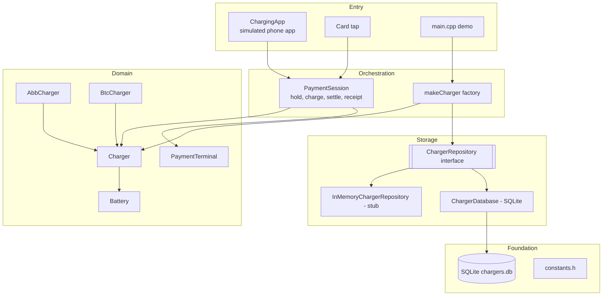

# EV Charger Simulation: How It Works

A C++20 simulation of an EV charging session: a car battery is charged by one of three charger types, paid for through a card terminal or started from a phone app, and every part is covered by 344 automated tests.

**Everything is simulated.** The ABB and BTC specs, the payment terminal and every number are made up. Nothing talks to real hardware or a real payment system.

One charge: a driver taps a card or presses Start in the app, a payment hold is placed, the charger pushes energy into the battery until the driver stops it, the hold runs out or the battery fills, then the real cost is captured and the rest of the hold released. A receipt records the battery's energy before and after.

Charger models (power, price, fee, taper) are read from a SQLite database, so they can change without recompiling. The code is a library plus a small demo program, built by CMake, tested by GoogleTest, packaged in a Docker image and checked on every push by GitHub Actions.

## Architecture

Every charge enters through the phone app, a card tap or the demo, passes one session or factory, and ends in the domain classes. Storage hides behind an interface. Each layer calls only layers below it.

Build and test tooling (CMake + Ninja, GoogleTest, Docker, GitHub Actions) surrounds the code rather than being part of it.

## Components

| Layer | Component | Responsibility | Depends on |
|---|---|---|---|
| Entry | `ChargingApp` | Simulated phone app: start/stop commands, connection state, status screen, notification events | `PaymentSession`, `Charger`, `Battery` |
| Entry | `main.cpp` | Demo: opens the database, builds every charger, runs one charge on each | `ChargerDatabase`, factory |
| Orchestration | `PaymentSession` | One paid charge: hold, charge within budget, settle, receipt with before/after energy | `PaymentTerminal`, `Charger`, `Battery` |
| Orchestration | `makeCharger` | Turns a stored spec into the right `Charger` class | `ChargerRepository`, charger classes |
| Domain | `Charger` | State machine (available, connected, charging, finished, faulted); energy and cost tracking; overridable delivered power and session fee | `Battery` |
| Domain | `AbbCharger`, `BtcCharger` | Power taper (ABB) and fixed session fee (BTC) | `Charger` |
| Domain | `Battery` | Energy, state of charge, level (empty, low, normal, full), time to full | none |
| Domain | `PaymentTerminal` | Simulated card terminal: authorize, capture, release, offline switch | none |
| Storage | `ChargerRepository` | Interface for reading and writing charger specs | `ChargerSpec` |
| Storage | `ChargerDatabase` | SQLite implementation | SQLite |
| Storage | `InMemoryChargerRepository` | Test stub with the same rules as the database | none |
| Shared | `constants.h` | Every tunable number, type name and default path | none |

The gmock mock (`MockChargerRepository`) lives in `tests/` and is not shipped.

## Key flows

**Card-tap flow** (`PaymentSession`)

1. `start(hold)` asks the terminal for a hold. If declined, the terminal is offline, or a hold already exists, nothing else happens.
2. The charger plugs in the battery and starts charging. If that fails, the hold is released. The battery energy is recorded as the "before" reading.
3. `charge(seconds, kw)` asks the charger how much power it will actually deliver (an ABB taper applies here), works out how many kWh the remaining money buys, and charges only that much. If the money runs out first it stops and flags the budget as used up.
4. The charger adds energy to the battery, capped at capacity. When full, the charger finishes by itself.
5. `finish()` stops charging, records the "after" reading, captures the real cost (never more than the hold), releases the rest, unplugs and returns a receipt.

**Phone-app flow** (`ChargingApp`)

1. `startCharge(budget)` checks in order: budget is positive, the phone is connected, no session is running, the charger is available. Then it runs the card-tap flow's `start`. The result says which check failed, or `PaymentDeclined`.
2. `advance(seconds, kw)` is the simulated clock. It drives the session and sends each notification once: `BudgetReached` or `BatteryFull`.
3. `stopCharge()` needs a connection. It runs `finish()` and returns the receipt, even if the charge already ended on its own.

**When things go wrong**

| Situation | Result |
|---|---|
| Card declined or terminal offline at start | No charging, no hold left behind |
| Charger faulted or occupied at start | App returns `ChargerUnavailable`; no hold is placed (a direct card tap places one, then releases it) |
| Money runs out first | Charging stops; billed exactly the hold; app sends `BudgetReached` |
| Battery fills first | Charger finishes by itself; unused hold released; app sends `BatteryFull` |
| Phone goes offline mid-charge | Stop fails with `NotConnected`; charger keeps going until reconnect |
| Terminal drops before capture | Receipt says `paid = false`; energy delivered but nothing billed |
| Charger fault mid-charge | Delivered energy is still settled; fault cleared at the end |

## Charger types and data

The three types differ in two overridable rules on `Charger`: how much power is delivered, and what fixed fee a session carries. All values are simulated defaults.

| Type | Max power | Default price | What is different |
|---|---|---|---|
| Generic | 11 kW | $0.30 / kWh | Nothing: delivers the request up to the cap, no fee |
| ABB | 150 kW | $0.45 / kWh | Above 80% battery charge, power drops to 50% of max. The taper is decided once per `charge()` call |
| BTC | 60 kW | $0.40 / kWh | A $1.00 session fee applies once charging starts, once per session |

Charger models live in one SQLite table, `chargers`. The database rejects bad rows itself, even if another tool writes them:

| Column | Rule |
|---|---|
| `name` | Unique and not empty |
| `type` | One of `generic`, `abb`, `btc` |
| `max_power_kw`, `price_per_kwh` | Greater than 0 |
| `session_fee` | 0 or more |
| `taper_above_percent` | 0 to 100 |
| `taper_factor` | Greater than 0, at most 1 |

The rest of the program never talks to SQLite directly. It uses the `ChargerRepository` interface, which has three implementations: the SQLite `ChargerDatabase`, an in-memory stub for fast tests, and a gmock mock for tests that check the conversation with storage. Values are bound parameters, so a charger name containing quotes or SQL is stored as plain text.

The factory `makeCharger` reads one row and builds the matching class. A price changed in the database affects chargers built afterward; a running charger keeps the values it was built with.

## Testing strategy

344 GoogleTest tests in seven groups, each its own program so it can be run, rebuilt and shown separately. Line coverage of the library is 99.5% (395 of 397 lines).

| Group | Tests | What it covers |
|---|---|---|
| `battery` | 18 | Energy, state of charge, charge levels |
| `charger` | 91 | State machine, ABB and BTC rules, shared contract tests on every type |
| `payment` | 36 | Payment terminal and payment session |
| `app` | 33 | Phone app, including offline behaviour |
| `database` | 73 | SQLite, stub and mock repositories, factory |
| `payter_master` | 42 | End-to-end: charge started by a card tap |
| `app_master` | 51 | End-to-end: charge started from the app |

Four techniques keep the suite honest:

- **Contract tests.** One set of tests runs against all three charger types, another against both the real SQLite repository and the in-memory stub. If the stub ever behaves differently from the database, a test fails.
- **Mocks and stubs.** The factory is tested with a gmock `StrictMock` repository, which fails on any unexpected call. This checks that the factory only reads, and that storage errors reach the caller.
- **Master suites.** Each runs its scenarios (14 and 17) on every charger type and checks shared rules on every receipt: the battery's gain equals the energy delivered, the charge never exceeds the hold, and charged plus released equals the hold.
- **Coverage gate.** CI fails if line coverage drops below 95%. Branch coverage is lower (66.8%), mostly in error paths inside the SQLite wrapper.

The master suites found one real bug during development: when the battery filled before the money ran out, the session wrongly reported the budget as used up. It is fixed in `src/payment_session.cpp`.

## Build, CI/CD and delivery

- **Build.** CMake with Ninja. On first configure it downloads GoogleTest 1.15.2 and the SQLite 3.54.1 source, pinned by SHA-256 hash so a changed download is rejected. Nothing needs installing on the machine.
- **Tests.** `ctest` runs all 344, or one group (`ctest -R '^battery\.'`). VS Code's CMake Tools shows the groups in its Testing panel.
- **Coverage.** `scripts/coverage.sh` builds with `--coverage`, runs the tests and writes an HTML report with `gcovr`. Only the project's own library is measured.
- **Docker.** A two-stage Dockerfile builds and tests in the first stage, then copies only the demo binary into a 102 MB runtime image. It runs as a non-root user and keeps the database in a `/data` volume.
- **GitHub Actions.** Three jobs on every push and pull request: build and test; coverage with a 95% line gate and the HTML report uploaded; Docker image build with a smoke test.
- **Releases.** A `v0.1.0` tag was created locally; pushing it and publishing the GitHub release are manual steps.

Branch protection on `main` (require a pull request and the three checks) is recommended but is a GitHub setting, not part of the code.

## Design decisions and limitations

**Decisions**

- **Behaviour through virtual functions, data through the database.** New charger types override two functions; new models of an existing type are just database rows.
- **Storage behind an interface.** Business logic can be tested without SQLite, and the stub is checked against the real database by shared tests.
- **Money safety first.** A charge can never bill more than the hold; a failed payment is reported, not hidden.
- **GoogleTest.** Chosen for parameterized tests and built-in mocking, both heavily used here.

**Limitations**

- A charger reads its spec once, when built; later database changes reach only chargers built afterward.
- ABB's power taper is decided per `charge()` call, so long steps are not realistic.
- If payment capture fails after charging, the driver is not billed and there is no retry or collection step.
- The app only sends commands and has no live feed from the charger; the clock is simulated.
- The stub's validation rules in C++ and the table's SQL constraints must be kept in step by hand; the shared tests catch only the rules they exercise.
- The default constructors for ABB and BTC still use values from `constants.h` rather than the database.
- The demo is a run-and-exit program, not a service with an API, and no software licence has been chosen.

**Possible next steps:** a service layer with an API in front of the library, retry handling for failed captures, a time-stepped charge curve, and branch protection on `main`.
